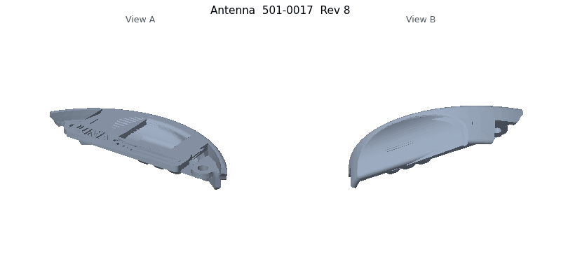
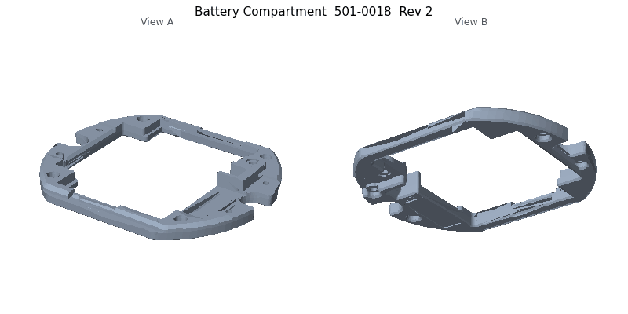
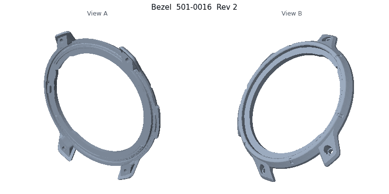
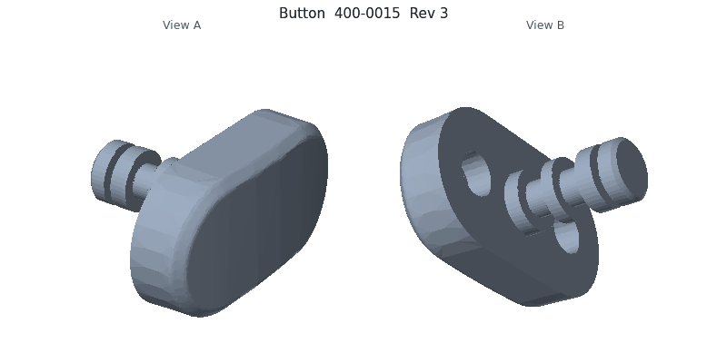
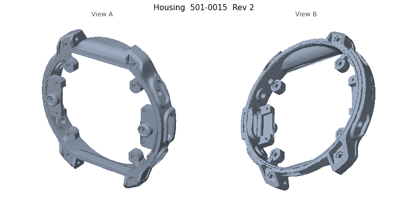
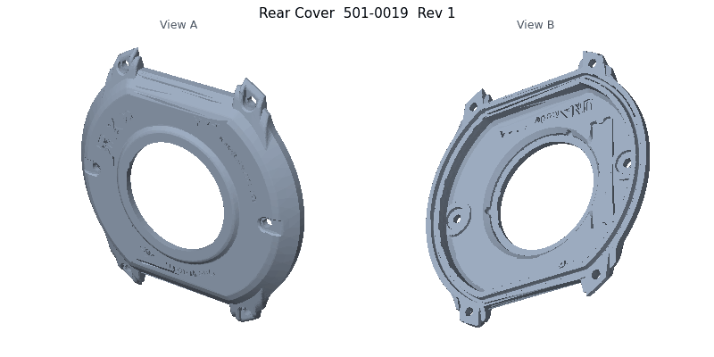
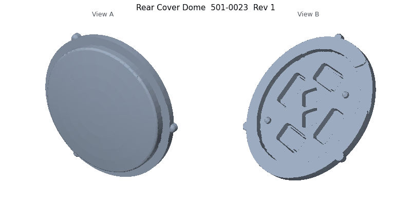

# mechanical

<!-- stp-previews:start -->
<!-- Generated by scripts/stp-previews/render.py; edits inside these markers are overwritten. -->

| Preview | Part | Part number | Rev | Size (mm) | Triangles |
|---|---|---|---|---|---|
|  | [Antenna](Antenna_501-0017_Rev-8.stp) | 501-0017 | 8 | 34.4 x 13.2 x 6.5 | 9,214 |
|  | [Battery Compartment](Battery_Compartment_501-0018_Rev-2.stp) | 501-0018 | 2 | 39.1 x 33.5 x 4.0 | 10,162 |
|  | [Bezel](Bezel_501-0016_Rev-2.stp) | 501-0016 | 2 | 46.5 x 5.8 x 49.1 | 24,614 |
|  | [Button](Button_400-0015_Rev-3.stp) | 400-0015 | 3 | 5.3 x 7.5 x 4.0 | 4,140 |
|  | [Housing](Housing_501-0015_Rev-2.stp) | 501-0015 | 2 | 47.5 x 9.4 x 49.2 | 46,587 |
|  | [Rear Cover](Rear_Cover_501-0019_Rev-1.stp) | 501-0019 | 1 | 45.5 x 4.8 x 46.4 | 41,041 |
|  | [Rear Cover Dome](Rear_Cover_Dome_501-0023_Rev-1.stp) | 501-0023 | 1 | 23.1 x 3.0 x 22.5 | 13,798 |

Previews are two shaded views from opposite corners. Part orientation comes from each STEP file's own coordinates.
<!-- stp-previews:end -->
